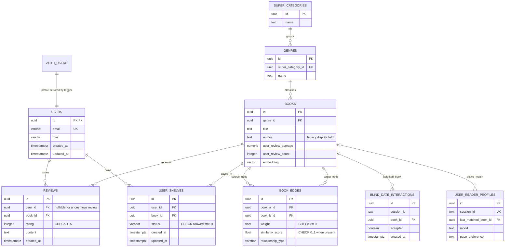

# ChapterOne — ER diagram and core data dictionary

This diagram represents the core relations evidenced by the repository's Prisma schema and SQL migrations. Confirm names/types against the live Supabase schema before using it as final submission evidence.

## Relationships and design rationale

- `USERS` is the application profile/role table. Its `id` mirrors `auth.users.id` and is synchronized by a server-owned database trigger. Authenticated users can read their own row; users cannot assign or elevate their own role.
- `REVIEWS` relates one book to a review and optionally an authenticated author. Anonymous reviews have `user_id IS NULL`; only authenticated owners may update/delete their own attributed reviews.
- `USER_SHELVES` is the associative relation between users and books, with `UNIQUE(user_id, book_id)` enforcing at most one current shelf status per book/user pair.
- `BOOK_EDGES` is a weighted graph edge between two books. Self-loops are disallowed by the existing schema and negative weights are rejected by the hardening migration.
- `USER_READER_PROFILES.last_matched_book_id` represents the active blind-date match; the reveal RPC consumes that match and records the accept/reject interaction in one transaction.
- `user_review_average` and `user_review_count` are separate from `community_rating`, which can represent imported/external ratings. The trigger must not overwrite external-source values.

## Constraints/indexes to demonstrate

- Primary keys: UUID identifiers.
- Foreign keys: `reviews.book_id`, `reviews.user_id`, `user_shelves.book_id`, `user_shelves.user_id`, `genres.super_category_id`, `books.genre_id`, `book_edges.book_a_id`, `book_edges.book_b_id`, `blind_date_interactions.book_id`, and `user_reader_profiles.last_matched_book_id`.
- Uniqueness: `users.email`, `books.external_id`, `authors.name`, `user_reader_profiles.session_id`, `(user_shelves.user_id, user_shelves.book_id)`, and `(book_edges.book_a_id, book_edges.book_b_id)`.
- Checks: review rating 1–5; allowed shelf status; distinct graph endpoints; nonnegative edge weights; similarity score within [0,1] when present; valid review-summary ranges.
- Indexes: HNSW for the embedding vector, FK/index pairs for graph edges, `(book_id, created_at DESC)` for review pages, `(user_id, status)` for shelf views, and `(session_id, book_id)` for exclusion/history lookups.

## Normalization caveat

The current UI and ingestion pipeline still consume some arrays (`tags`, `fiction_genres`) and a legacy `books.author` display string. For a strict 3NF claim, migrate these to `tags`/`book_tags`, `fiction_genres`/`book_fiction_genres`, and `authors`/`book_authors` relations, then update all API queries and ingestion code. Keep the existing columns until that compatibility migration has been separately tested and the data backfill reconciled.
