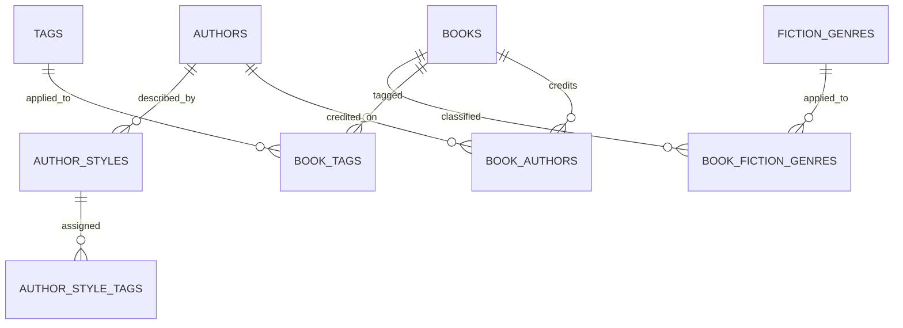

# Book Store: route to a defensible 3NF schema

## Current status

The DBMS hardening migration improves constraints, referential integrity, RLS, transactional behavior, and review aggregates. It does **not** by itself make the complete existing schema 3NF. The current application still consumes multi-valued arrays such as `books.tags`, `books.fiction_genres`, and `authors.ai_style`, and stores author credits as a denormalized `books.author` display string even though an `authors` table also exists.

Do not write “the entire schema is in 3NF” in the final report until the normalization steps below have been applied, reconciled, and the legacy attributes have been removed or replaced by read-only projections.

## Target normalized relations

| Relation | Candidate key / constraints | Purpose |
|---|---|---|
| `authors` | `id` PK, normalized `name` unique | One entity per verified author |
| `book_authors` | `(book_id, author_id)` PK; `position` unique per book | Many-to-many book/author relationship and display order |
| `tags` | `id` PK; normalized `name` unique | Atomic reusable tag vocabulary |
| `book_tags` | `(book_id, tag_id)` PK | Many-to-many book/tag relationship |
| `fiction_genres` | `id` PK; `slug` unique | Fiction-specific matching vocabulary |
| `book_fiction_genres` | `(book_id, fiction_genre_id)` PK | Many-to-many fiction classification |
| `author_styles` | `id` PK; normalized `name` unique | Reusable writing-style vocabulary |
| `author_style_tags` | `(author_id, style_id)` PK | Many-to-many author/style relationship |

Every relationship must have a foreign key with an intentional delete rule, and all relation lookup columns need indexes appropriate to the application queries. Do not copy `book_title`, `author_name`, or other descriptive attributes into junction tables unless they describe the relationship itself.

## Safe migration sequence

1. **Create the new relations first.** Add foreign keys, unique constraints, checks, indexes, and RLS before moving app traffic. Keep legacy columns intact during the transition.
2. **Backfill only unambiguous data.** `tags` and `fiction_genres` arrays can be expanded into junction rows after trimming and deduplicating values. Preserve a mapping report with original value, normalized value, and row count.
3. **Do not split author strings on commas automatically.** External data sources join author arrays using commas, while real names can also contain commas. Verify source metadata (e.g. provider author arrays / stable external IDs) or produce a manual review queue for ambiguous credits.
4. **Change reads and writes together.** Importers write normalized junction rows transactionally. Search and graph-building jobs read normalized tags/author relations. API responses can use a query/view that aggregates relations into arrays/display strings for compatibility, but those projections must not remain independently writable source-of-truth columns.
5. **Reconcile before cutover.** Compare per-book tag, fiction-genre, and author-credit counts; investigate every mismatch; run API, search, import, graph, and backfill tests in staging.
6. **Remove legacy duplicated fields in a later migration.** Only after all code paths read/write normalized relations should the array and author display columns be dropped or moved to a non-authoritative compatibility view.

## Evidence required before claiming 3NF

- The ER diagram matches the live PostgreSQL constraints, not just ORM declarations.
- No production API reads or writes the legacy arrays or `books.author` as authoritative data.
- Backfill audit results show no unexplained dropped/duplicated values.
- The migration can be run against a restored staging backup and rolled forward without manual schema edits.
- Search/import/graph tests pass after cutover, and the application can recreate any compatibility response from normalized relations.
